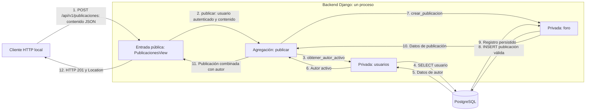
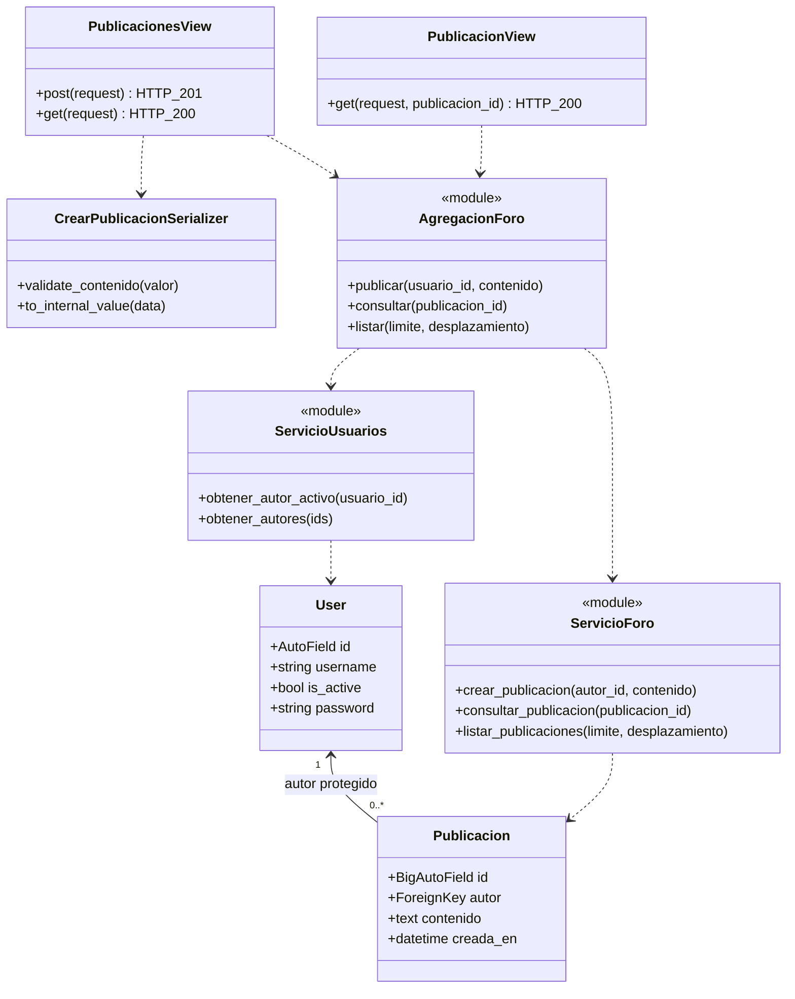

# HU1 — contrato implementado en P1

Estado: implementación local pendiente de revisión del equipo. Los resultados de pruebas se registran en C2_P1_REVISION.md. Diagramas digitales preparados como referencia; no se afirma validación en papel.

## Requisito de origen

HU1: crear publicaciones para compartir dudas o información con la comunidad.

- HU1-E1: al ingresar contenido y confirmar, el sistema guarda la publicación y la muestra en el foro.
- HU1-E2: al intentar publicar sin contenido, el sistema no crea la publicación y muestra un mensaje para completar el contenido.

Fuente: Anexo A del informe C1. El identificador y enlace individual de Taiga siguen sin verificarse; no confundir HU1 con una referencia numérica inventada de Taiga.

## Identidad de demostración

Todas las operaciones requieren Basic con una cuenta activa de prueba. Solo se admite en desarrollo y desde loopback. El cliente no escoge autor mediante el body. Esto permite probar propiedad de publicaciones sin implementar JWT, login público o integración React. Es una decisión técnica local para P1, pendiente de revisión del equipo; la seguridad integrada de C3 sigue fuera de alcance.

## Crear publicación

`POST /api/v1/publicaciones`, sin barra final. Content-Type: application/json.

Sin parámetros de ruta ni de consulta. Body exacto:

```json
{"contenido": "¿Cómo cuidan sus acuarios?"}
```

Validaciones:

- contenido debe existir y ser una cadena JSON, no null, número, lista ni objeto.
- Después de quitar espacios y saltos de línea de los extremos, no puede quedar vacío.
- No se admiten NUL ni secuencias Unicode no codificables en UTF-8, por compatibilidad con PostgreSQL.
- No se admiten campos adicionales, incluyendo autor_id.
- El cuerpo tiene un límite técnico de 1 MiB configurado en Django; no es una regla histórica de la HU.

Respuesta 201; Location apunta al detalle creado:

```json
{
  "id": 1,
  "contenido": "¿Cómo cuidan sus acuarios?",
  "creada_en": "2026-10-29T12:00:00+00:00",
  "autor": {"id": 1, "nombre": "joaquin_demo"}
}
```

Los IDs y fecha del ejemplo son ilustrativos. creada_en es ISO 8601 con zona horaria, generada por el servidor. El texto se guarda sin espacios exteriores. La escritura es real y sobrevive al reinicio del servidor.

Contenido vacío devuelve 400, sin insertar:

```json
{"error": {"codigo": "datos_invalidos", "detalles": {"contenido": ["Debe completar el contenido."]}}}
```

## Lecturas necesarias para mostrar lo creado

`GET /api/v1/publicaciones/{id}`: devuelve 200 con el mismo esquema; 404 si el ID numérico no corresponde a una publicación. No hay body ni parámetros de consulta.

`GET /api/v1/publicaciones`: devuelve el foro en orden creada_en descendente e ID descendente. Parámetros opcionales:

| Parámetro | Tipo | Predeterminado | Validación |
|---|---|---|---|
| limite | entero | 20 | 1 a 100 |
| desplazamiento | entero | 0 | 0 a 2147483647 |

Respuesta 200:

```json
{"total": 0, "limite": 20, "desplazamiento": 0, "resultados": []}
```

resultados contiene publicaciones con el esquema de creación. total cuenta todas las publicaciones; no solo la página. Los límites son técnicos para evitar lecturas ilimitadas. Parámetros desconocidos o inválidos devuelven 400. La búsqueda por tema se reserva a HU3/P4; todavía no se acepta tema.

Estas lecturas son soporte del Entonces de HU1-E1; no constituyen nuevas historias.

## Errores HTTP de las operaciones

| Código | Cuándo | error.codigo |
|---|---|---|
| 400 | Datos incompletos/incorrectos, JSON inválido o parámetros inválidos | datos_invalidos |
| 401 | Credenciales ausentes/incorrectas, cuenta inactiva o Basic fuera del contexto local de desarrollo | no_autenticado |
| 404 | Publicación solicitada inexistente | no_encontrado |
| 405 | Método no implementado | metodo_no_permitido |
| 406 | Cliente no acepta JSON | formato_respuesta_no_admitido |
| 415 | POST con formato diferente de JSON | tipo_contenido_no_admitido |

Forma común: error.codigo y error.detalles. detalles puede ser un mapa de campos, un mapa con detail o una lista según el error de DRF. El texto específico de errores estructurales puede variar con la traducción de DRF; usar código y campos como referencia estable. Errores ajenos a las vistas, como URL desconocida o cuerpo demasiado grande, usan el manejo de Django y no se presentan como errores funcionales de HU1.

## Recorrido dinámico C4 de creación

Alcance: componentes de un único contenedor backend Django. Basic y sus consultas de identidad son un control previo a la operación funcional. PostgreSQL es un almacén separado. No hay HTTP entre capas internas.



Alternativa HU1-E2: en el paso 7, el servicio detecta contenido vacío y devuelve error hacia agregación y capa pública; esta responde 400. No se ejecuta INSERT. Un tipo incorrecto se rechaza ya en la entrada pública.

## Clases y operaciones de P1

El dominio es funcional: sus servicios y la agregación son módulos con funciones, no clases Python inventadas. El diagrama representa las clases reales de modelo y de entrada HTTP, con dependencias a esos módulos.



User es el modelo incorporado de Django. Su atributo password contiene un hash, nunca la contraseña en texto. No se devuelve en la API.

## Trazabilidad

| HU / escenario | Flujo y secuencia de origen | Endpoint | Componente | Prueba |
|---|---|---|---|---|
| HU1-E1 | Foto 2 HU1, Foto 6 HU1; recorrido exitoso | POST y GET de publicaciones | Entrada pública → agregación → foro/usuarios | test_hu1_e1_crea_persiste_y_muestra_en_foro |
| HU1-E2 | Foto 2 HU1, rama No; alternativa a agregar a Foto 6 | POST /api/v1/publicaciones | Validación privada + conversión pública a error HTTP | test_hu1_e2_contenido_vacio_no_escribe |

Las pruebas adicionales verifican tipos, errores de transporte, autenticación local, suplantación, orden/paginación, restricción de base y separación de capas. No se presentan como escenarios históricos nuevos de Taiga.
