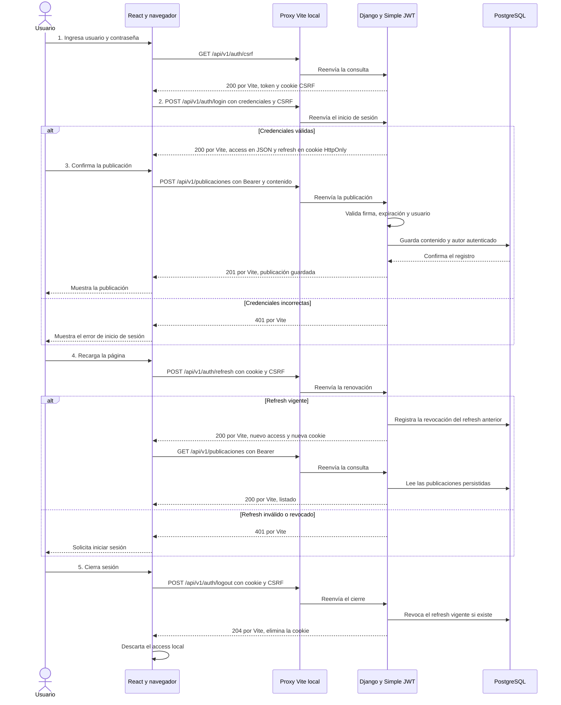

# AquaLife · C3 Integración y seguridad

**Universidad Andrés Bello · Desarrollo Web y Móvil (PTEC103)**

**Profesor:** Sebastián I. Alvarado Aceituno

**Equipo:** Joaquín Leiva y Kenneth Qian

**Entrega:** 22 de noviembre de 2026

## Propósito y punto de partida

AquaLife integra la interfaz React de C1 con la API y la persistencia de C2. El punto de partida fue el árbol publicado en `94ec255670c11b079d2a3ca3365caffde5627e14`. C2 ya tenía reglas de negocio, migraciones PostgreSQL y contratos para foro, peces, ranking y avisos. C3 conserva esas capas e incorpora sesión de navegador, cliente HTTP tipado, formularios conectados y recuperación de datos tras recargar.

## Arquitectura y seguridad

El navegador usa una URL relativa `/api/v1`. En desarrollo, Vite reenvía la petición a Django en loopback. Django REST Framework valida la firma, expiración e identidad JWT antes de llegar a la capa pública de negocio. Agregación coordina casos de uso, dominio aplica reglas y consulta PostgreSQL con el ORM. El contrato de negocio queda recogido en `docs/api/c2.openapi.json`. Los cuatro endpoints de sesión C3 se describen en `docs/C3_HU1.md`.

El Access Token dura cinco minutos y solo permanece en memoria. El refresh de un día vive en una cookie HttpOnly de ruta limitada, con SameSite Lax y Secure fuera del perfil de desarrollo. Una renovación rota el refresh anterior y la lista de revocación de Simple JWT impide reutilizarlo. Una transacción y un bloqueo sobre el refresh coordinan renovaciones concurrentes. Al cerrar sesión se revoca el refresh y se elimina la cookie. Un access emitido expira al terminar su vigencia. Las operaciones de sesión exigen CSRF y el origen local autorizado está definido explícitamente. La firma JWT usa una clave distinta a la clave Django. Las credenciales de demo son locales.

La autorización sigue aplicada en el backend. Los datos de peces y avisos se consultan por usuario, el pez ajeno devuelve 404 y los votos propios o repetidos conservan los rechazos de C2. Registrar una publicación toma el autor del usuario validado por Django. El dispositivo independiente se deja fuera del diseño acordado de esta entrega. El temario lo aborda y la evaluación solicita un mapeo JWT.

## Mapeo del flujo JWT

Un JWT es un comprobante firmado que Django entrega después de validar las credenciales. La firma permite detectar cambios en el token. El access autoriza solicitudes a la API durante cinco minutos. El refresh permite obtener otro access y viaja en una cookie que JavaScript no puede leer. Django aplica las reglas de cada operación después de identificar al usuario.

Las respuestas del diagrama vuelven por el proxy local. Si una petición protegida recibe `401` por un access vencido, React intenta renovar la sesión y repite la petición una vez. Django devuelve `403` si falla CSRF o si la identidad autenticada intenta votar por su propia pecera. El detalle de un pez ajeno responde `404`. Los pasos para reproducir el dibujo están en [Mapeo JWT para dibujar en papel](C3_MAPEO_JWT.md).

## Historias y trazabilidad

| HU | Flujo verificable | Taiga |
|---|---|---|
| HU1 | Publicar y comprobar persistencia al recargar | [#5](https://tree.taiga.io/project/jleivav-aqua-life/us/5) |
| HU2 | Comentar y ver el comentario asociado | [#6](https://tree.taiga.io/project/jleivav-aqua-life/us/6) |
| HU3 | Buscar publicación por tema y consultar el resultado vacío | [#7](https://tree.taiga.io/project/jleivav-aqua-life/us/7) |
| HU4 | Registrar un pez vinculado a una especie y verlo en la lista propia | [#8](https://tree.taiga.io/project/jleivav-aqua-life/us/8) |
| HU5 | Buscar una especie y abrir características y cuidados | [#9](https://tree.taiga.io/project/jleivav-aqua-life/us/9) |
| HU6 | Editar un pez propio y comprobar la actualización tras recargar | [#10](https://tree.taiga.io/project/jleivav-aqua-life/us/10) |
| HU7 | Registrar e inscribir una pecera completa | [#11](https://tree.taiga.io/project/jleivav-aqua-life/us/11) |
| HU8 | Votar y comprobar rechazo de voto propio o repetido | [#12](https://tree.taiga.io/project/jleivav-aqua-life/us/12) |
| HU9 | Consultar posiciones, empates y categorías vacías | [#13](https://tree.taiga.io/project/jleivav-aqua-life/us/13) |
| HU10 | Ver el aviso de una respuesta publicada por otra cuenta | [#14](https://tree.taiga.io/project/jleivav-aqua-life/us/14) |
| HU11 | Ver el aviso al cambiar la posición de una pecera | [#15](https://tree.taiga.io/project/jleivav-aqua-life/us/15) |
| HU12 | Guardar preferencias y comprobar que se omite el aviso desactivado | [#16](https://tree.taiga.io/project/jleivav-aqua-life/us/16) |

Las referencias siguen los enlaces entregados por el equipo y el orden de historias del Anexo A de C1. Los borradores de PR conservan ese mapeo para la revisión de ambos integrantes.

## Simulación

El escenario usa el volumen, los parámetros configurados, la duración y el intervalo seleccionados. El control de tiempo recorre las muestras y aplica el horario de iluminación a cada hora. Los valores de agua se mantienen en los niveles ingresados. La escena visual es ilustrativa. El alcance aprobado para esta versión es una visualización interactiva de parámetros.

## Verificación y entrega

Se verifican las reglas de persistencia y permisos con la suite Django sobre PostgreSQL, más un recorrido con dos sesiones en Edge desde React. El protocolo reproducible y el resultado de la corrida están en `C3_VERIFICACION.md`.

La preparación de aportes se divide en cuatro bloques funcionales por integrante. Cada borrador identifica su dependencia, historia y evidencia. Los cambios de cierre académico y de Simulación se presentan como trabajo compartido separado de los ocho bloques funcionales. El historial de PR real se añade después de que sus responsables revisen y publiquen sus bloques.

## Conclusión

La interfaz consume la API C2 con sesión JWT, operaciones protegidas y persistencia PostgreSQL. La demostración incluye dos usuarios y permite observar el efecto de una escritura, una restricción de permisos y la preferencia de notificación durante la misma ejecución.
